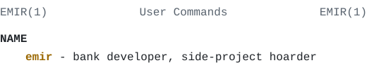

<picture>
  <source media="(prefers-color-scheme: dark)" srcset="./assets/man-dark.svg" />
  <source media="(prefers-color-scheme: light)" srcset="./assets/man-light.svg" />
  
</picture>

#### <samp>SYNOPSIS</samp>

```
emir [--at-work unicredit]
     [--after-hours skin-to-scan
                  | tinyrex
                  | panelos]
```

#### <samp>DESCRIPTION</samp>

I'm a software developer at UniCredit: PL/SQL, Oracle APEX, Jasper reports, and Python scripts that stop someone from doing the same thing by hand every morning. Before that I built RPA bots at NLB and Virgin Pulse, which is a polite way of saying I taught computers to click buttons.

After hours I build small products and find out which ones anyone actually wants.

#### <samp>PROJECTS</samp>

<dl>
  <dt><samp><a href="https://skintoscan.com">skin-to-scan</a></samp></dt>
  <dd>Photo of a mole in, CNN screening result out. Awareness, not a diagnosis.</dd>
  <dt><samp><a href="https://apify.com/tinyrex">tinyrex</a></samp></dt>
  <dd>A dozen pay-per-result scrapers on Apify: job boards, Shopify, WooCommerce, EU tenders. <a href="https://emirmrkaljevic.github.io/tinyrex-data-tools/">Guides</a>.</dd>
  <dt><samp><a href="https://emirmrkaljevic.github.io/panelos-site/">panelos</a></samp></dt>
  <dd>Windows app for the small USB screen in a PC case: temps, load, and what Spotify is playing.</dd>
  <dt><samp><a href="https://hatt.at">hatt</a></samp></dt>
  <dd>Where Skin to Scan lives, plus tools for grant matching and asset inventories.</dd>
</dl>

#### <samp>HISTORY</samp>

UniCredit (2024-). NLB and Virgin Pulse, RPA (2023-24). Interned at Tech For Good and Info Studio, the latter in React and TypeScript. BSc in Software Engineering, PCAP certified.

#### <samp>ENVIRONMENT</samp>

`PYTHON` `PLSQL` `SQL` `TYPESCRIPT` `REACT` `ORACLE_APEX`

#### <samp>SEE ALSO</samp>

[hatt.at](https://hatt.at), [skintoscan.com](https://skintoscan.com), [apify.com/tinyrex](https://apify.com/tinyrex)

#### <samp>BUGS</samp>

Will show you PanelOS if you ask. Sometimes if you don't.
