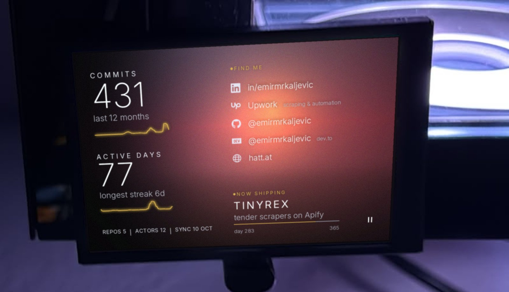

That's the screen in my PC case running <a href="https://emirmrkaljevic.github.io/panelos-site/">PanelOS</a>, the Windows app I'm launching. Instead of CPU temps it shows my GitHub numbers. A GitHub Action re-renders it every morning with the app's own theme code.

<b>Find me:</b> <a href="https://www.linkedin.com/in/emirmrkaljevic">LinkedIn</a> · <a href="https://www.upwork.com/freelancers/~010819c711770f4f81">Upwork</a> · <a href="https://github.com/emirmrkaljevic">GitHub</a> · <a href="https://dev.to/emirmrkaljevic">dev.to</a> · <a href="https://hatt.at">hatt.at</a>

### Hi, I'm Emir

I'm a software developer at UniCredit. Most days that means PL/SQL, Oracle APEX, Jasper reports, and Python scripts that stop someone from doing the same thing by hand every morning. Before that I built RPA bots at NLB and Virgin Pulse, which is a polite way of saying I taught computers to click buttons.

The rest of my time goes into things I build myself.

### What I run

<table>
  <tr>
    <td width="50%" valign="top">
      
      
<b><a href="https://hatt.at">HATT</a></b> My product studio. Focused software for operations, funding and health work, the kind that's too complex to live in spreadsheets.

    </td>
    <td width="50%" valign="top">
      
      
<b><a href="https://skintoscan.com">Skin to Scan</a></b> Upload a photo of a mole and a CNN gives you a screening result. It's for awareness, not a diagnosis, and it tells you that. I founded it and built it.

    </td>
  </tr>
</table>

### On the side

- **[TinyRex](https://apify.com/tinyrex)**: a dozen pay-per-result scrapers on Apify for job boards, Shopify and WooCommerce stores, and EU and US tenders. [Guides and examples](https://emirmrkaljevic.github.io/tinyrex-data-tools/).
- **[PanelOS](https://emirmrkaljevic.github.io/panelos-site/)**: the thing in the photo. It drives the small USB screens people put in PC cases: temps, load, and whatever Spotify is playing.

---

[LinkedIn](https://www.linkedin.com/in/emirmrkaljevic) · [Upwork](https://www.upwork.com/freelancers/~010819c711770f4f81) · [dev.to](https://dev.to/emirmrkaljevic) · [hatt.at](https://hatt.at) · [skintoscan.com](https://skintoscan.com) · [apify.com/tinyrex](https://apify.com/tinyrex) · [PanelOS](https://emirmrkaljevic.github.io/panelos-site/)
