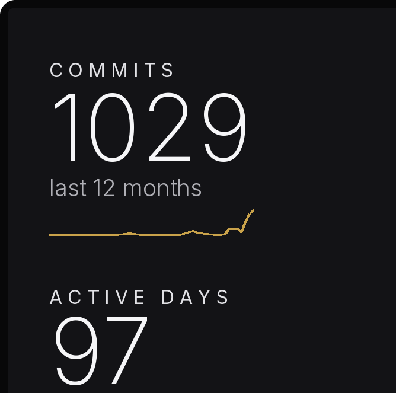
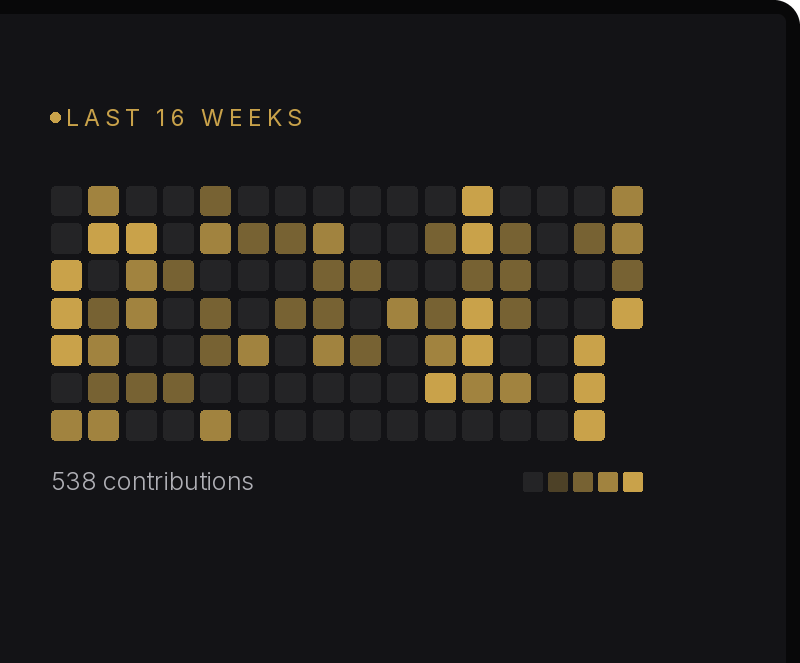
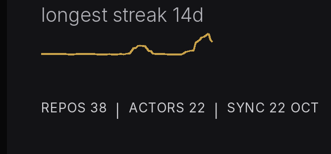
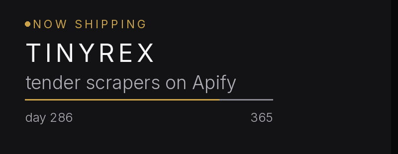
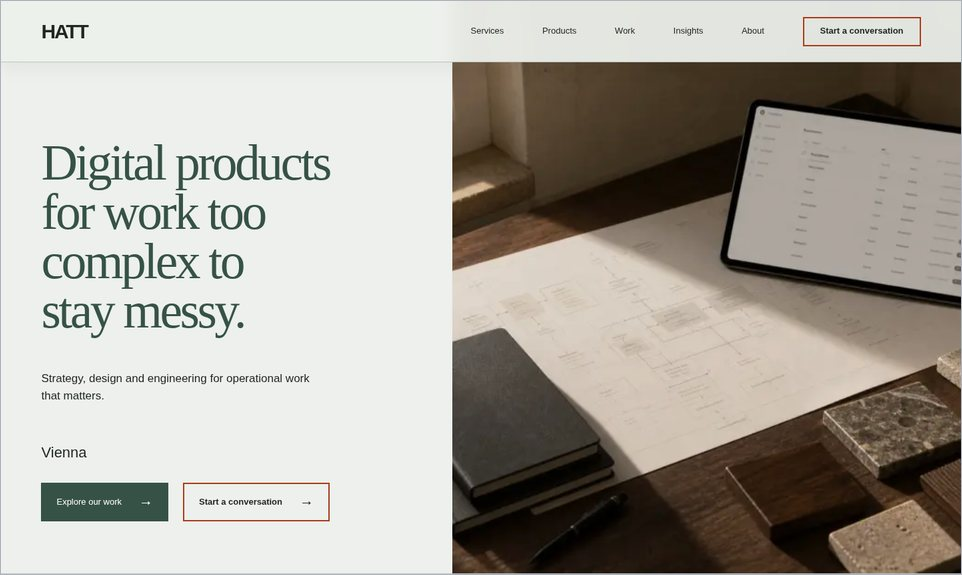

<!-- hero:start -->

  

<!-- hero:end -->

The screen is <a href="https://emirmrkaljevic.github.io/panelos-site/">PanelOS</a>, the Windows app I'm building for the small USB screens people put in PC cases. Here it shows my GitHub numbers instead of CPU temps, rendered every morning with the app's own theme code. The bottom row links out.

 If you find this useful, you can support me by getting a SkinToScan pack, my other project. It's a one-time purchase that directly funds my open-source work.

  

### What I run

<table>
  <tr>
    <td width="50%" valign="top">
      
      
<b><a href="https://hatt.at">HATT</a></b> My product studio. Focused software for operations, funding and health work, the kind that's too complex to live in spreadsheets.

    </td>
    <td width="50%" valign="top">
      
      
<b><a href="https://skintoscan.com">Skin to Scan</a></b> Upload a photo of a mole and a CNN gives you a screening result. It's for awareness, not a diagnosis, and it tells you that. I founded it and built it.

    </td>
  </tr>
</table>

### On the side

- **[TinyRex](https://apify.com/tinyrex)**: a dozen pay-per-result scrapers on Apify for job boards, Shopify and WooCommerce stores, and EU and US tenders. [Guides and examples](https://emirmrkaljevic.github.io/tinyrex-data-tools/).
- **[PanelOS](https://emirmrkaljevic.github.io/panelos-site/)**: the app on that screen. It drives the small USB screens people put in PC cases: temps, load, and whatever Spotify is playing.

### Open source

- **[usb-rea](https://github.com/emirmrkaljevic/usb-rea)**: point it at a USB gadget that only works with a vendor app. It captures the traffic, works out the protocol and writes an open Python/libusb driver. CLI and MCP server.
- **[iotaudit](https://github.com/emirmrkaljevic/iotaudit)**: audit your own smart-home devices (who they talk to, encryption, open ports, idle uploads, A–F grade report). CLI and MCP server.
- **[behave](https://github.com/emirmrkaljevic/behave)**: records how a CLI behaves (flags, stdin, exit codes, edge cases) so you can check that your Rust or Go rewrite does the same. Go, CLI and MCP server.
- **[shrinkwatch-eu](https://github.com/emirmrkaljevic/shrinkwatch-eu)**: a Chrome and Firefox extension for EU and Balkan supermarket web shops. Shows price per kg or litre and warns when a pack got smaller for the same price.
- **[truediscount](https://github.com/emirmrkaljevic/truediscount)**: a Chrome and Firefox extension that checks if a shop discount is real by comparing the old price with the lowest price of the last 30 days (EU Omnibus rule). Shows a small price graph and keeps all data in the browser.
- **[mesh2cad](https://github.com/emirmrkaljevic/mesh2cad)**: turns a scanned or printed STL mesh back into an editable STEP CAD model with exact planes, cylinders and spheres. CLI and MCP server.

### Contributions

- **[ESPnet](https://github.com/espnet/espnet)** (Carnegie Mellon's speech processing toolkit): added `use_sdpa` to the GST style encoder and fixed a missing `dropout_rate` that broke training with it on. [#6889](https://github.com/espnet/espnet/pull/6889), merged.
- **[ESPnet](https://github.com/espnet/espnet)** again: passed `use_sdpa` through the SLU `TransformerPostEncoder`. [#6906](https://github.com/espnet/espnet/pull/6906), merged.
- **[ESPnet](https://github.com/espnet/espnet)** once more: passed `use_sdpa` through the SLU `ConformerPostEncoder`, including the legacy relative-position attention it uses by default. [#6933](https://github.com/espnet/espnet/pull/6933), merged.
- **[uutils coreutils](https://github.com/uutils/coreutils)** (the Rust rewrite of GNU coreutils): found with [behave](https://github.com/emirmrkaljevic/behave) that `cut --output-delimiter` rejected values starting with `-`. Reported in [#15341](https://github.com/uutils/coreutils/issues/15341); fixed upstream in [#15345](https://github.com/uutils/coreutils/pull/15345).
- **[uutils coreutils](https://github.com/uutils/coreutils)** again: found with [behave](https://github.com/emirmrkaljevic/behave) that `sort --check --merge` ignored `--check` and merged instead of reporting disorder. Reported in [#15380](https://github.com/uutils/coreutils/issues/15380) and fixed in [#15381](https://github.com/uutils/coreutils/pull/15381), merged.
- **[uutils coreutils](https://github.com/uutils/coreutils)** once more: found with [behave](https://github.com/emirmrkaljevic/behave) that `tac --separator` rejected values starting with `-`. Reported in [#15497](https://github.com/uutils/coreutils/issues/15497) and fixed in [#15498](https://github.com/uutils/coreutils/pull/15498), merged.
- **[uutils coreutils](https://github.com/uutils/coreutils)** again: `tail` reformatted numeric-looking file names in error messages (`007` became `7`, `1e3` became `1000`); now it keeps them verbatim like GNU (part of [#15533](https://github.com/uutils/coreutils/issues/15533)). [#15534](https://github.com/uutils/coreutils/pull/15534), merged.
- **[uutils coreutils](https://github.com/uutils/coreutils)** once more: `tac` did the same in read errors (a directory named `007` was shown as `7`); now it keeps the name verbatim like GNU (part of [#15533](https://github.com/uutils/coreutils/issues/15533)). [#15541](https://github.com/uutils/coreutils/pull/15541), merged.
- **[uutils coreutils](https://github.com/uutils/coreutils)** again: `nl` did the same when a directory had a numeric-looking name (`007` was shown as `7`); now it keeps the name verbatim like GNU (part of [#15533](https://github.com/uutils/coreutils/issues/15533)). [#15544](https://github.com/uutils/coreutils/pull/15544), merged.
- **[uutils coreutils](https://github.com/uutils/coreutils)** once more: the shared checksum code behind `md5sum` and `cksum` reformatted numeric-looking file names in errors and `--check` warnings (`1e3` became `1000`); now they stay verbatim like GNU (part of [#15533](https://github.com/uutils/coreutils/issues/15533)). [#15548](https://github.com/uutils/coreutils/pull/15548), merged.
- **[uutils coreutils](https://github.com/uutils/coreutils)** again: found with [behave](https://github.com/emirmrkaljevic/behave) that bare `tail -c` and `tail +NUM` ignored `_POSIX2_VERSION`, unlike GNU. Reported in [#15528](https://github.com/uutils/coreutils/issues/15528) and fixed in [#15529](https://github.com/uutils/coreutils/pull/15529), merged.
- **[uutils coreutils](https://github.com/uutils/coreutils)** once more: added a test that `md5sum --check --warn` keeps numeric-looking file names verbatim in bad-format warnings, as a follow-up the maintainer asked for (part of [#15533](https://github.com/uutils/coreutils/issues/15533)). [#15559](https://github.com/uutils/coreutils/pull/15559), merged.
- **[uutils diffutils](https://github.com/uutils/diffutils)** (the Rust rewrite of GNU diffutils): made `diff -u`/`-c` merge hunks separated by up to twice the context size, like GNU diff (fixes [#268](https://github.com/uutils/diffutils/issues/268)). [#306](https://github.com/uutils/diffutils/pull/306), merged.
- **[uutils diffutils](https://github.com/uutils/diffutils)** again: added the insertion case from [#268](https://github.com/uutils/diffutils/issues/268) to the unified and context hunk merging tests, as a follow-up the maintainer asked for. [#307](https://github.com/uutils/diffutils/pull/307), merged.
- **[TensorBlock awesome-mcp-servers](https://github.com/TensorBlock/awesome-mcp-servers)** (an MCP server index): added [mesh2cad](https://github.com/emirmrkaljevic/mesh2cad) to the Multimedia Processing list. [#3825](https://github.com/TensorBlock/awesome-mcp-servers/pull/3825), merged.
- **[TensorBlock awesome-mcp-servers](https://github.com/TensorBlock/awesome-mcp-servers)** again: added [usb-rea](https://github.com/emirmrkaljevic/usb-rea) to the Hardware & IoT list. [#3944](https://github.com/TensorBlock/awesome-mcp-servers/pull/3944), merged.
- **[TensorBlock awesome-mcp-servers](https://github.com/TensorBlock/awesome-mcp-servers)** once more: added [behave](https://github.com/emirmrkaljevic/behave) to the Code Analysis & Quality list. [#3955](https://github.com/TensorBlock/awesome-mcp-servers/pull/3955), merged.
- **[awesome-mcp-servers](https://github.com/punkpeye/awesome-mcp-servers)** (the largest community list of MCP servers): added [usb-rea](https://github.com/emirmrkaljevic/usb-rea). [#16364](https://github.com/punkpeye/awesome-mcp-servers/pull/16364), merged.
- **[awesome-reverse-engineering](https://github.com/morluto/awesome-reverse-engineering)** (a curated reverse engineering list): added [usb-rea](https://github.com/emirmrkaljevic/usb-rea) to the Firmware and hardware section. [#13](https://github.com/morluto/awesome-reverse-engineering/pull/13), merged.
- **[awesome-testing](https://github.com/TheJambo/awesome-testing)** (a curated list of software testing resources): added [behave](https://github.com/emirmrkaljevic/behave) to Test Automation Frameworks. [#299](https://github.com/TheJambo/awesome-testing/pull/299), merged.

---

[LinkedIn](https://www.linkedin.com/in/emirmrkaljevic) · [Upwork](https://www.upwork.com/freelancers/~010819c711770f4f81) · [dev.to](https://dev.to/emirmrkaljevic) · [hatt.at](https://hatt.at) · [skintoscan.com](https://skintoscan.com) · [apify.com/tinyrex](https://apify.com/tinyrex) · [PanelOS](https://emirmrkaljevic.github.io/panelos-site/)
