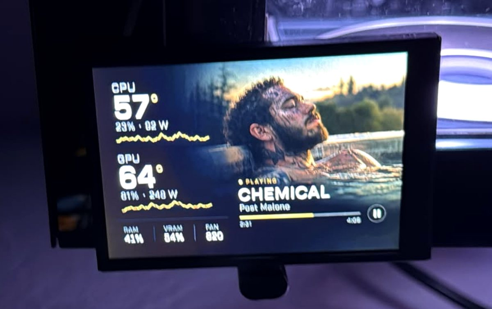

## Hi, I'm Emir

I'm a software developer at UniCredit. Most days that means PL/SQL, Oracle APEX, Jasper reports, and Python scripts that stop someone from doing the same thing by hand every morning.

Before the bank I built RPA bots at NLB and Virgin Pulse, which is a polite way of saying I taught computers to click buttons. Before that, internships at Info Studio (React, TypeScript) and Tech For Good. BSc in Software Engineering, PCAP certified.

After hours I build small products and find out which ones anyone actually wants.

PanelOS on the little screen in my PC case. Temps are fine. The playlist is a separate conversation.

### What I'm working on

- **[Skin to Scan](https://skintoscan.com)**: upload a photo of a mole and a CNN gives you a screening result. It's for awareness, not a diagnosis, and it tells you that.
- **[TinyRex](https://apify.com/tinyrex)**: a dozen scrapers on Apify for job boards, Shopify and WooCommerce stores, and EU tenders. You pay per result. There are [guides and examples](https://emirmrkaljevic.github.io/tinyrex-data-tools/) too.
- **[PanelOS](https://emirmrkaljevic.github.io/panelos-site/)**: the app in the photo. A Windows app for those small USB screens in PC cases: temps, load, and whatever Spotify is playing.
- **[HATT](https://hatt.at)**: where Skin to Scan lives, along with a few tools for grant matching and asset inventories.

### What I write

Python, PL/SQL, SQL, TypeScript and React. Oracle APEX when the bank asks nicely.

---

[hatt.at](https://hatt.at) · [skintoscan.com](https://skintoscan.com) · [apify.com/tinyrex](https://apify.com/tinyrex)
