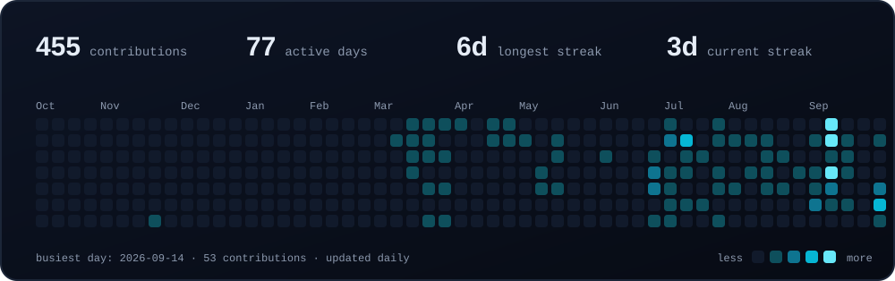

<p align="center">
  
</p>

<p align="center">
  <a href="https://hatt.at"></a>
  <a href="https://skintoscan.com"></a>
  <a href="https://apify.com/tinyrex"></a>
  <a href="https://emirmrkaljevic.github.io/panelos-site/"></a>
</p>

<br />

<p align="center">
  
</p>

<p align="center">
  I write the PL/SQL, Oracle APEX and Python automation that banking runs on,<br />
  and in my own time I ship products: an AI skin-screening platform, a dozen data tools, and a desktop app for PC case screens.
</p>

## ✦ What I'm building

<table>
  <tr>
    <td width="50%" valign="top">
      <a href="https://skintoscan.com"></a>
      <br /><b><a href="https://skintoscan.com">Skin to Scan</a></b> · founder &amp; developer<br />
      <sub>Upload a photo of a mole or lesion and get a CNN-based screening result. Built for awareness, not diagnosis.</sub>
    </td>
    <td width="50%" valign="top">
      <a href="https://apify.com/tinyrex"></a>
      <br /><b><a href="https://apify.com/tinyrex">TinyRex</a></b> · data tools on Apify<br />
      <sub>Jobs, e-commerce, EU tenders &amp; grants, tech-stack detection. Pay per result, callable by AI agents. <a href="https://emirmrkaljevic.github.io/tinyrex-data-tools/">Guides →</a></sub>
    </td>
  </tr>
  <tr>
    <td width="50%" valign="top">
      <a href="https://emirmrkaljevic.github.io/panelos-site/"></a>
      <br /><b><a href="https://emirmrkaljevic.github.io/panelos-site/">PanelOS</a></b> · Windows app<br />
      <sub>Turns the small screen in your PC case into a live panel: temps, load and Spotify album art. Zero setup.</sub>
    </td>
    <td width="50%" valign="top">
      <a href="https://hatt.at"></a>
      <br /><b><a href="https://hatt.at">HATT</a></b> · product studio<br />
      <sub>Focused digital products for workflow-critical work across health, funding and operations.</sub>
    </td>
  </tr>
</table>

## ✦ Toolbox

<p align="center">
  
</p>
<p align="center">
  <code>PL/SQL</code> <code>Oracle APEX</code> <code>JasperReports</code> <code>RPA</code> <code>CNNs</code> <code>Apify</code>
</p>

## ✦ Path

```text
$ git log --oneline --career
* 2024-10  UniCredit · Software Developer
           PL/SQL · Oracle APEX · Jasper · Python
* 2024-07  Skin to Scan · Founder & Developer
           AI/ML · CNNs
* 2024     Virgin Pulse · RPA Developer
* 2023-24  NLB Bank · RPA Developer
* 2023     Tech For Good Inc · Intern
* 2022-23  Info Studio · Intern · React, TypeScript
* init     BSc Software Engineering · PCAP certified
```

## ✦ Last 12 months

<p align="center">
  
</p>

<p align="center">
  
</p>
